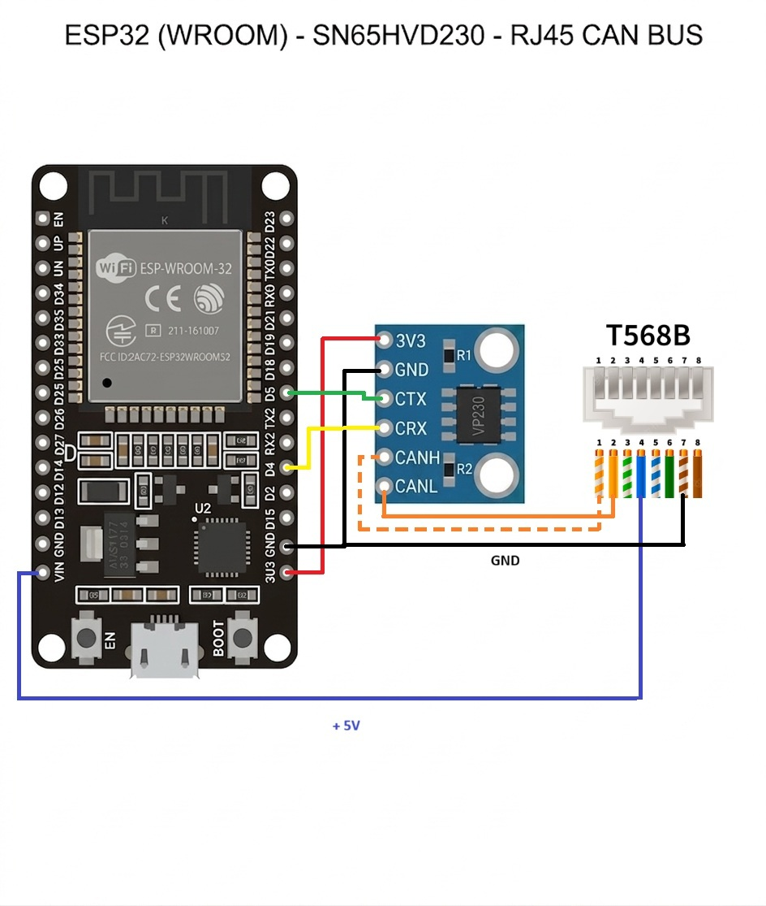

# BMZ Elios CAN Sniffer dla ESPHome i Home Assistant

Projekt oparty na mikrokontrolerze **ESP32** oraz transceiverze **CAN SN65HVD230**, służący do bezpiecznego, pasywnego podsłuchiwania (tryb *Listen-Only*) i dekodowania szyny CAN magazynów energii **BMZ Elios** (obsługa do 4 modułów równolegle) z integracją w Home Assistant przez ESPHome.

> ⚠️ **Uwaga:** projekt jest nieoficjalny i nie jest powiązany z firmą BMZ. Urządzenie jedynie nasłuchuje magistrali CAN, jednak podłączasz je do instalacji magazynu energii **na własną odpowiedzialność**.

## 🛠 Wymagania

* **Mikrokontroler:** ESP32 DevKit 1 (ESP-WROOM-32)
* **Transceiver CAN:** SN65HVD230 (zasilanie 3,3 V)
* **Magazyn energii:** BMZ Elios (prędkość magistrali: `500 kbps`)
* **Oprogramowanie:** [ESPHome](https://esphome.io/) i Home Assistant
* **Przetestowano z:** ESPHome 2026.4.0 (framework ESP-IDF)

## 🔌 Schemat podłączenia



### ESP32 ↔ transceiver SN65HVD230

| ESP32 | Transceiver SN65HVD230 | Opis |
|-------|------------------------|------|
| **GPIO 5** | CTX (TX) | Linia nadawania do transceivera (w trybie Listen-Only urządzenie nie nadaje na szynie) |
| **GPIO 4** | CRX (RX) | Odbiór danych z szyny |
| **3V3** | 3V3 | Zasilanie transceivera |
| **GND** | GND | Masa |

### Transceiver / ESP32 ↔ gniazdo RJ45 magazynu BMZ (T568B)

| Pin RJ45 | Kolor żyły (T568B) | Sygnał | Podłączenie |
|----------|--------------------|--------|-------------|
| **1** | biało-pomarańczowy | CAN High | CANH transceivera |
| **2** | pomarańczowy | CAN Low | CANL transceivera |
| **4** | niebieski | +5 V | pin **VIN** płytki ESP32 (zasila BMZ) |
| **7** | biało-brązowy | GND | GND (wspólna masa) |

* ESP32 jest zasilany przez port **USB** płytki. Linia +5 V z pinu VIN trafia do magazynu BMZ (pin 4), a nie odwrotnie.
* Przypisanie żył odpowiada schematowi powyżej – przed podłączeniem upewnij się, że zgadza się z Twoim egzemplarzem magazynu.

> 💡 **Wskazówka:** wiele gotowych modułów z SN65HVD230 ma na płytce rezystor terminujący 120 Ω. Jeśli magistrala jest już terminowana przez magazyn energii, upewnij się, że nie dokładasz drugiego terminatora.

---

## 🚀 Instalacja i konfiguracja

1. Sklonuj lub pobierz repozytorium na swój komputer.
2. Skopiuj plik `secrets.yaml.example` jako `secrets.yaml` (w tym samym katalogu co `bmz_elios_can.yaml`) i uzupełnij go własnymi danymi:

   ```yaml
   wifi_ssid: "Twoja_Nazwa_WiFi"
   wifi_password: "Twoje_Haslo_WiFi"
   api_encryption_key: "WKLEJ_TUTAJ_WYGENEROWANY_KLUCZ_BASE64"
   ota_password: "Twoje_Haslo_OTA"
   fallback_ap_password: "Twoje_Haslo_Hotspotu"
   ```

   Klucz `api_encryption_key` to 32 bajty zakodowane w base64. Wygenerujesz go np. poleceniem `openssl rand -base64 32` albo skopiujesz z kreatora nowego urządzenia w ESPHome Dashboard. Hasło `fallback_ap_password` musi mieć co najmniej 8 znaków.

3. Sprawdź poprawność konfiguracji:

   ```bash
   esphome config bmz_elios_can.yaml
   ```

4. Skompiluj i wgraj oprogramowanie na ESP32:

   ```bash
   esphome run bmz_elios_can.yaml
   ```

5. Po uruchomieniu urządzenie zostanie wykryte w Home Assistant (**Ustawienia → Urządzenia i usługi**). Dodaj je do integracji ESPHome, podając klucz `api_encryption_key` z `secrets.yaml`.

Kolejne aktualizacje możesz wgrywać bezprzewodowo (OTA) tą samą komendą `esphome run`.

---

## 📊 Zdekodowane parametry w Home Assistant

Projekt tworzy m.in.:

* **Encje systemowe:** sumaryczny SOC, prąd, napięcie średnie, moc całkowita oraz maksymalna delta napięcia ogniw.
* **Encje per moduł (1–4):** napięcie, prąd, stan naładowania (SOC), temperatura średnia, min/max, temperatury poszczególnych 6 czujników, statusy pracy oraz napięcia i stany balansowania dla wszystkich 16 ogniw w każdym module.
* **Diagnostykę:** statusy połączenia (Heartbeat), wykrywanie aktywności falownika, detekcję rozbieżności oraz wersję firmware.

## 📝 Uwagi

* Urządzenie pracuje wyłącznie w trybie **Listen-Only** – nie wysyła żadnych ramek na magistralę CAN.
* GPIO 5 jest pinem strappingowym ESP32. W konfiguracji ESPHome ostrzeżenie o tym zostało świadomie wyciszone.
* Historia zmian znajduje się w komentarzu na początku pliku `bmz_elios_can.yaml`.

## 📁 Zawartość repozytorium

| Plik | Opis |
|------|------|
| `bmz_elios_can.yaml` | konfiguracja ESPHome |
| `secrets.yaml.example` | szablon pliku z hasłami i kluczami |
| `wiring-diagram.jpg` | schemat połączeń |
| `LICENSE` | licencja PolyForm Noncommercial 1.0.0 |
| `.gitignore` | wyklucza `secrets.yaml` i pliki robocze ESPHome |

## 📄 Licencja

Projekt jest udostępniany na licencji **[PolyForm Noncommercial 1.0.0](https://polyformproject.org/licenses/noncommercial/1.0.0)** (pełny tekst w pliku [`LICENSE`](LICENSE)).

W skrócie:

* wolno go używać, modyfikować i udostępniać dalej **do celów niekomercyjnych** (np. hobbystycznych, edukacyjnych, na własny użytek),
* **nie wolno** go sprzedawać ani używać komercyjnie,
* przy udostępnianiu dalej trzeba zachować linię `Required Notice` z informacją o autorze oraz tekst licencji.

To jedynie streszczenie. Wiążący jest pełny tekst licencji.

## 👤 Autor

**badbrain07**
